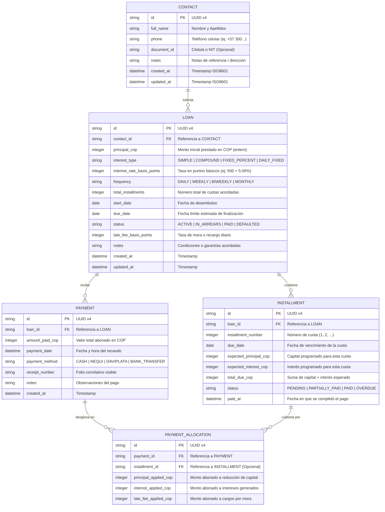

# Relational Database Schema & Data Architecture (CuentasClaras)

## Reglas de Integridad y Consistencia
1. **Regla de Caja**: `PAYMENT.amount_paid_cop == sum(PAYMENT_ALLOCATION.principal_applied_cop + interest_applied_cop + late_fee_applied_cop)`.
2. **Prioridad de Cascada de Pagos**:
   - Primero se cubren los cargos de mora pendientes.
   - Segundo se cancelan los intereses corrientes vencidos de la cuota más antigua.
   - Tercero el excedente amortiza directamente al capital (`principal`).
3. **Estado del Préstamo**: Si la fecha actual supera `INSTALLMENT.due_date` y el balance de cuota pendiente es $> 0$, el préstamo pasa automáticamente al estado `IN_ARREARS` (En Mora).
